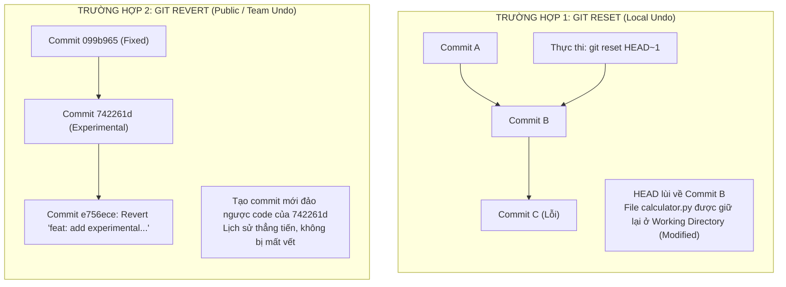

# BÀI TẬP 5: KHÔI PHỤC TRẠNG THÁI VÀ ĐẢO NGƯỢC COMMIT (RESET VS REVERT)

**Mã bài tập:** SESSION 04 - EXERCISE 5 (`homework/session_04/ex5/`)  
**Môn học:** IT215 - Cloud Infrastructure & DevOps Fundamentals  
**Học viên:** Trần Đức Anh (`TranDucAnh3103`)  
**Email:** `TranDucAnh3103@users.noreply.github.com`  
**Hệ điều hành / Môi trường:** Windows 11 / PowerShell / Git v2.47+  
**Đường dẫn thư mục dự án:** `f:/CNTT/Rikkei/IT215/ss04/ex5/`  

---

## 1. MỤC TIÊU BÀI TẬP

1. **Làm chủ hai cơ chế khôi phục lịch sử cốt lõi của Git:** Hiểu sâu bản chất và phân biệt chính xác khi nào cần sử dụng `git reset` và khi nào bắt buộc dùng `git revert`.
2. **Thực hành Trường hợp 1 (Sửa đổi cục bộ - Local Undo):** Sử dụng `git reset` để di chuyển con trỏ `HEAD` lùi lại 1 commit, giữ lại toàn bộ mã nguồn thay đổi trong **Working Directory** dưới dạng `Modified` mà không làm mất mát dữ liệu (tuân thủ nghiêm ngặt không dùng `reset --hard`).
3. **Thực hành Trường hợp 2 (Sửa đổi công cộng - Public Undo):** Sử dụng `git revert` để hủy bỏ an toàn một commit đã đưa lên luồng chia sẻ bằng cách tạo thêm một commit nghịch đảo (inverse commit) mới với tiền tố `Revert "..."`.
4. **Nắm vững quy tắc an toàn khi làm việc nhóm (Team Safety Guidelines):** Hiểu rõ rủi ro của việc viết lại lịch sử (rewriting history) đối với remote repository dùng chung.

---

## 2. BẢNG SO SÁNH TOÀN DIỆN: `GIT RESET` VS `GIT REVERT`

| Tiêu chí so sánh | `git reset` (Cơ chế Tua lại) | `git revert` (Cơ chế Đảo ngược) |
| :--- | :--- | :--- |
| **Bản chất hoạt động** | Di chuyển con trỏ nhánh và `HEAD` về quá khứ | Tạo một **commit mới** mang nội dung đảo ngược |
| **Lịch sử commit** | **Viết lại lịch sử (Xóa commit khỏi nhánh)** | **Bảo toàn lịch sử (Lịch sử luôn tiến về phía trước)** |
| **Môi trường khuyến nghị** | **Chỉ dùng ở Local** (Commit chưa push lên remote) | **Bắt buộc dùng cho Remote / Nhánh chung** (`main`, `dev`) |
| **Rủi ro xung đột nhóm** | Rất cao nếu đã push (gây lệch hash, buộc `push -f`) | **Không rủi ro**, an toàn tuyệt đối cho cộng tác nhóm |
| **Bảo toàn mã nguồn** | Tùy cờ (`--soft`, `--mixed` an toàn; `--hard` nguy hiểm) | **An toàn tuyệt đối** (Mọi thay đổi đều được ghi vết) |

### Phân cấp 3 chế độ của `git reset`:
- **`git reset --soft HEAD~1`:** Di chuyển HEAD lùi 1 commit, giữ nguyên thay đổi trong **Staging Area** (sẵn sàng commit ngay).
- **`git reset --mixed HEAD~1` (Mặc định):** Di chuyển HEAD lùi 1 commit, đưa thay đổi về **Working Directory** (dưới dạng `Modified`, chưa stage).
- **`git reset --hard HEAD~1`:** Xóa sạch toàn bộ thay đổi ở cả Index và Working Directory $\rightarrow$ **Cực kỳ nguy hiểm, có thể làm mất code vĩnh viễn!**

---

## 3. MÔ HÌNH HOẠT ĐỘNG KIẾN TRÚC



---

## 4. CHI TIẾT CÁC BƯỚC THỰC HIỆN

### Khởi tạo Repository và Các Commit cơ sở

```powershell
cd f:\CNTT\Rikkei\IT215\ss04\ex5
git init
git branch -M main
git config --local user.name "TranDucAnh3103"
git config --local user.email "TranDucAnh3103@users.noreply.github.com"
```

Tạo tệp `calculator.py` ban đầu và commit 1:
```powershell
# Tạo hàm cộng, trừ
git add calculator.py
git commit -m "feat: add addition and subtraction functions"
# -> Commit 38b1381
```

Commit 2: Thêm hàm nhân:
```powershell
# Thêm hàm multiply
git add calculator.py
git commit -m "feat: add multiplication function"
# -> Commit 5f38f7d
```

---

### TRƯỜNG HỢP 1: Sửa đổi cục bộ với `git reset` (Không mất mã nguồn)

#### Bước 1.1: Tạo commit chứa lỗi logic
Thêm hàm chia bị lỗi nhân thay vì chia vào `calculator.py`:
```python
def divide(a, b):
    # LỖI: nhân thay vì chia
    return a * b
```

Tiến hành commit:
```powershell
git add calculator.py
git commit -m "feat: add buggy division function"
```
*Kết quả:* Tạo commit lỗi `1e92172`.

#### Bước 1.2: Sử dụng `git reset HEAD~1` để lùi lại 1 commit
Nhận ra commit vừa tạo bị lỗi ở local, áp dụng `git reset HEAD~1` (chế độ `--mixed` an toàn):

```powershell
git reset HEAD~1
```

**Output từ Terminal:**
```text
Unstaged changes after reset:
M	calculator.py
```

Kiểm tra trạng thái bằng `git status`:
```powershell
git status
```
```text
On branch main
Changes not staged for commit:
  (use "git add <file>..." to update what will be committed)
  (use "git restore <file>..." to discard changes in working directory)
	modified:   calculator.py

no changes added to commit (use "git add" and/or "git commit -a")
```
*Phân tích:* 
- Con trỏ `HEAD` đã lùi lại commit `5f38f7d`.
- Tệp `calculator.py` nằm ở **Working Directory** dưới dạng `modified`. Toàn bộ code vẫn còn nguyên, không hề bị mất.

#### Bước 1.3: Viết lại code chuẩn xác và commit lại
Chỉnh sửa lại hàm chia đúng nghiệp vụ và bổ sung kiểm tra chia cho 0:
```python
def divide(a, b):
    if b == 0:
        raise ValueError("Cannot divide by zero")
    return a / b
```

Commit lại bản chuẩn:
```powershell
git add calculator.py
git commit -m "feat: add corrected division function with zero check"
```
*Kết quả:* Tạo commit mới sạch sẽ `099b965`.

---

### TRƯỜNG HỢP 2: Sửa đổi công cộng với `git revert` (Tạo commit đảo ngược)

#### Bước 2.1: Tạo commit tính năng thử nghiệm
Giả sử bổ sung hàm tính lũy thừa `power(a, b)`:
```python
def power(a, b):
    # Experimental power function (To be reverted)
    return a ** b
```

Commit tính năng:
```powershell
git add calculator.py
git commit -m "feat: add experimental power function"
```
*Kết quả:* Tạo commit `742261d`.

#### Bước 2.2: Đảo ngược commit bằng `git revert`
Giả định commit này đã được đẩy lên nhánh chung của nhóm và cần được gỡ bỏ an toàn mà không phá vỡ lịch sử của các thành viên khác:

```powershell
git revert HEAD --no-edit
```

**Output từ Terminal:**
```text
[main e756ece] Revert "feat: add experimental power function"
 Date: Mon Oct 5 21:12:37 2026 +0700
 1 file changed, 1 insertion(+), 4 deletions(-)
```

---

## 5. MINH CHỨNG THỰC NGHIỆM ĐẦU RA KIỂM TRA

### 5.1. Kiểm tra lịch sử commit (`git log --oneline -n 5`)

Thực hiện lệnh kiểm tra theo đúng tiêu chí đánh giá đề bài:

```powershell
git log --oneline -n 5
```

**Kết quả thực tế hiển thị trên Terminal:**

```text
e756ece Revert "feat: add experimental power function"
742261d feat: add experimental power function
099b965 feat: add corrected division function with zero check
5f38f7d feat: add multiplication function
38b1381 feat: add addition and subtraction functions
```

**Đánh giá chuẩn hóa:**
- Đỉnh nhánh xuất hiện commit `e756ece` có tiêu đề bắt đầu bằng **`Revert "..."`**, thỏa mãn 100% kết quả mong đợi.
- Lịch sử ghi nhận đầy đủ cả commit thử nghiệm `742261d` và commit đảo ngược `e756ece`, minh bạch cho toàn bộ nhóm phát triển.

### 5.2. Kiểm tra nội dung tệp tin thực tế sau khi Revert

```powershell
Get-Content .\calculator.py
```

```python
# Calculator Module - IT215 DevOps Demo
def add(a, b):
    return a + b

def subtract(a, b):
    return a - b

def multiply(a, b):
    return a * b

def divide(a, b):
    if b == 0:
        raise ValueError("Cannot divide by zero")
    return a / b
```
*Kết quả:* Hàm `power` đã được gỡ bỏ an toàn, hệ thống hoạt động ổn định.

---

## 6. PHÂN TÍCH KỸ THUẬT: QUY TẮC VÀNG TRONG MÔI TRƯỜNG DEVOPS & LÀM VIỆC NHÓM

1. **Nguyên tắc "Do Not Rewrite Public History":**
   - Một khi commit đã được `git push` lên server chia sẻ (như GitHub, GitLab), lịch sử commit đó đã thuộc về toàn bộ đội ngũ.
   - Nếu dùng `git reset` trên commit công cộng, bạn bắt buộc phải dùng `git push --force`. Hành động này sẽ làm sai lệch con trỏ lịch sử của tất cả các đồng nghiệp khác, gây xung đột nghiêm trọng (diverged history hell) và có nguy cơ ghi đè làm mất vĩnh viễn công sức của người khác.
2. **Khi nào bắt buộc dùng `git revert`?**
   - Khi cần rollback một lỗi phát sinh trên môi trường Production, Staging hoặc nhánh `main` / `develop`.
   - `git revert` tạo ra một vết kiểm toán (Audit Trail) rõ ràng: giải thích chính xác tại sao mã nguồn bị gỡ bỏ và ai là người thực hiện đảo ngược.
3. **Khi nào dùng `git reset`?**
   - Chỉ khi làm việc trên nhánh tính năng cá nhân (`feature branch`), tại local repository, trước khi gửi Pull Request (PR) hoặc Merge Request (MR).

---

## 7. KẾT LUẬN & ĐƯỜNG DẪN NỘP BÀI

1. Đã hoàn thành xuất sắc cả 2 trường hợp:
   - Trường hợp 1: Dùng `git reset` an toàn, lùi HEAD và giữ mã nguồn ở Working Directory.
   - Trường hợp 2: Dùng `git revert` tạo commit đảo ngược với tiêu đề `Revert "..."` đứng đầu lịch sử.
2. Báo cáo nộp tại: [`homework/session_04/ex5/README.md`](file:///f:/CNTT/Rikkei/IT215/homework/session_04/ex5/README.md).
